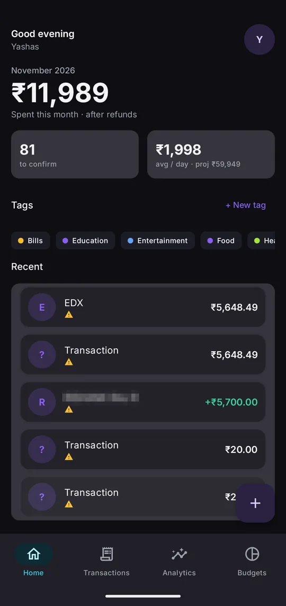
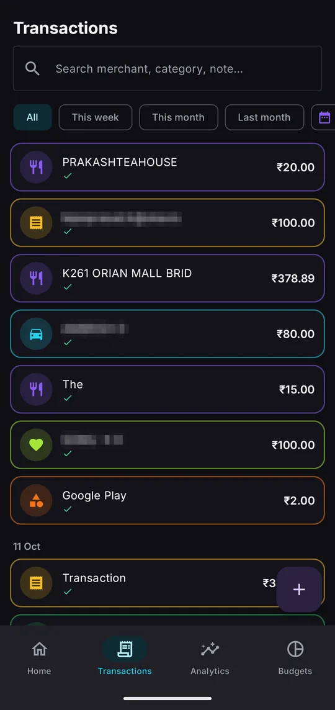
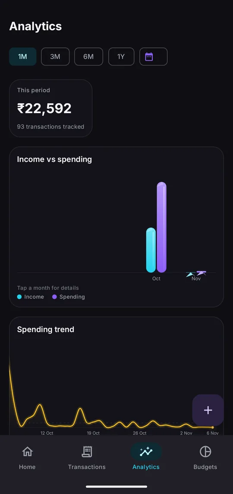
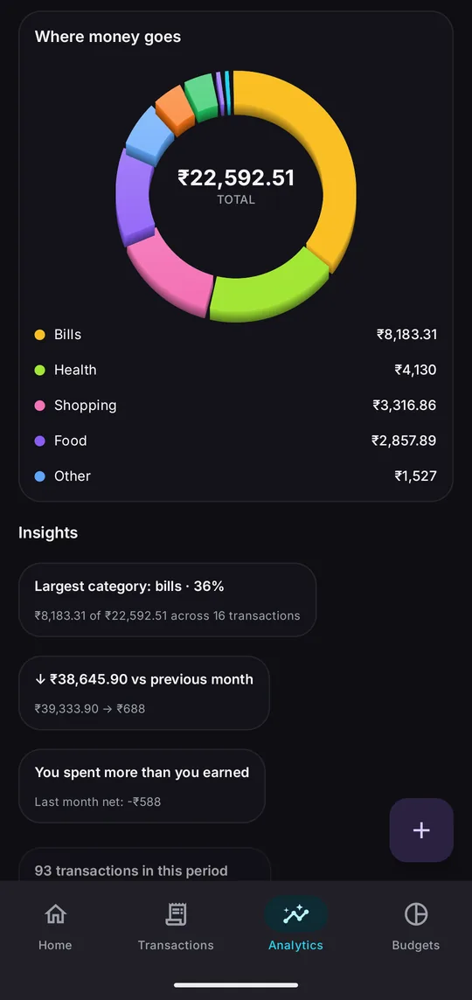
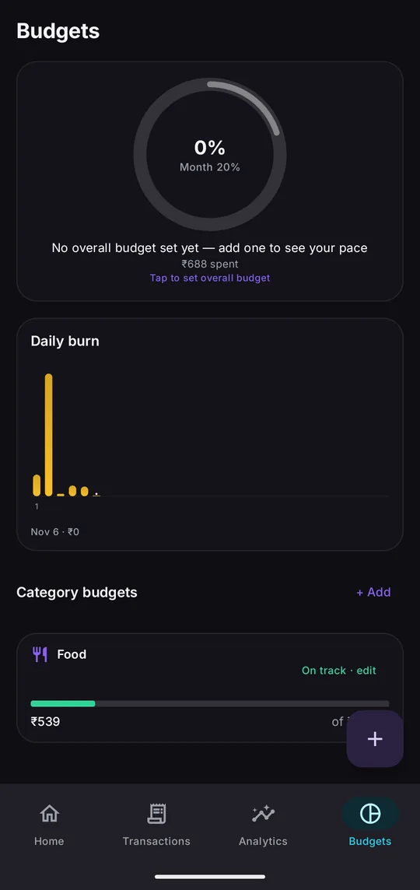

# Tyche

**An offline Android expense tracker that reads your bank SMS, never touches the internet, and makes sorting a month of spending take a few drags.**

Tyche turns the transaction messages your bank already sends into a ledger you can trust: every payment is captured automatically, waits for you to confirm it, and then feeds the charts and budgets. It has **no internet permission**, so nothing it reads can ever leave your phone.

Built for two people (my sister and me), and we both use it every day.

[**Download the latest APK →**](https://github.com/Yalt8826/Tyche-Expense_Tracker/releases) · Android 10+ · see the [caution](#caution) below

<p align="center">
  
  
  
  
  
</p>
<p align="center"><sub>Home · Transactions · Analytics · Where the money goes · Budgets. Other people's names and UPI IDs are pixelated.</sub></p>

---

## Features

- **Automatic capture from bank SMS.** New transaction messages are read as they arrive and turned into ledger entries: amount, direction, account, UPI ref, balance, merchant or UPI ID, and date.
- **Review inbox with drag-to-tag.** New transactions wait for confirmation, grouped by payee. Long-press a payee and it lifts into a circle while your tags orbit around it; drop it on a tag and every transaction from that payee is tagged at once. Real haptics (20 ms lift, 18 ms hover, 45 ms drop), a forgiving 2.2× capture radius, and undo.
- **Category suggestions without AI.** A bundled merchant dictionary plus your own tagging history ("you tagged this UPI ID as Food the last 6 times").
- **A real ledger.** Five transaction types (expense, income, transfer, refund, adjustment). Self-transfers are not counted as spending, refunds reverse the original expense, suspected duplicates get a *Keep both / Merge* card, and amounts are stored as whole paise, never floats.
- **Analytics.** Income vs spending, spending trend, where the money goes (donut), and plain-language insights.
- **Budgets.** An overall budget ring, per-category budgets and a daily burn chart.
- **Manual add** for cash and anything the SMS funnel misses.
- **Export.** CSV export and a backup file.

## How capture works

```text
Bank SMS (SMS_RECEIVED)
  → sender allowlist            drop anything not from a known bank, before any disk write
  → cheap screen                is there an amount and a debit/credit word?
  → per-bank template           named-group regex: amount, direction, account mask,
                                UPI ref, balance, merchant / UPI ID, date
  → generic fallback            amount + direction + date only
  → Review inbox                you confirm or correct once; the rule covers the rest
```

Bank SMS are machine-generated, so deterministic templates are enough. There is **no AI anywhere** in the app.

Bank templates are included for **Kotak, Bank of Baroda, HDFC, SBI, ICICI and Axis**. Kotak and Bank of Baroda have been tested against real messages; the others are based on published formats and may need adjusting.

**First real run:** against 21 days of real messages, Tyche stored 91 bank SMS, correctly ignored 102 promotions and OTPs, and produced 83 transactions in the review inbox.

## Privacy

Tyche's Android manifest does not request the `INTERNET` permission, so the operating system will not let it open a network connection at all. The privacy promise is kept by the build itself, not by a policy.

Permissions it does ask for:

| Permission | Why |
|---|---|
| `READ_SMS`, `RECEIVE_SMS` | to find and read bank transaction messages |
| `VIBRATE` | haptic feedback for drag-to-tag |

## Tech stack

| Layer | Choice |
|---|---|
| Language / UI | Kotlin, Jetpack Compose, Material 3 |
| Charts | [Vico](https://github.com/patrykandpatrick/vico) for line and bar charts; hand-drawn Compose Canvas for the donut, budget ring, income-vs-spending and trend visuals |
| Data | Room (SQLite), DataStore for preferences |
| Architecture | ViewModel + StateFlow, Navigation Compose |
| Capture | `SMS_RECEIVED` broadcast receiver → capture engine → Room |

## Project structure

```text
app/src/main/java/dev/yashas/expensetracker/
├── data/
│   ├── capture/    SMS receiver, bank templates, capture engine
│   ├── db/         Room database, entities, DAOs
│   ├── rules/      merchant dictionary, category seed, suggestion engine
│   ├── repo/       transaction, analytics and budget repositories
│   └── export/     CSV export and backup
├── domain/model/   enums and money formatting (paise)
└── ui/             home, ledger (review inbox + drag-to-tag), analytics, budgets,
                    quick add, settings, theme
```

Design documents live in [`docs/`](docs/): the [master spec](docs/00-MASTER-DESIGN-SPEC.md), [screens](docs/01-SCREENS.md), [charts](docs/02-CHARTS.md), [animation](docs/03-ANIMATION.md), [architecture](docs/04-TECH-ARCHITECTURE.md), the [decision log](docs/DECISIONS.md) and the [progress log](docs/PROGRESS.md).

## Building from source

Requirements: JDK 17 and the Android SDK (compile SDK 37, min SDK 29).

```sh
./gradlew assembleDebug        # app/build/outputs/apk/debug/
./gradlew test                 # unit tests
```

Debug builds include a demo-data seeder and a back-fill tool for messages that arrived before install; both are stripped from release builds.

## Status

Finished and in daily use by two people. The current download is **1.0.0-alpha1**, a debug build.

## Caution

This is an unofficial alpha build of a personal project, installed outside the Play Store. It is provided **as is, with no warranty of any kind**. By installing it you accept that you use it entirely at your own risk, and that I'm not responsible for any loss of data, money, or damage to your device that may result. You'll need to allow installs from unknown sources.

---

Made by [Yashas Gowda N](https://github.com/Yalt8826).
